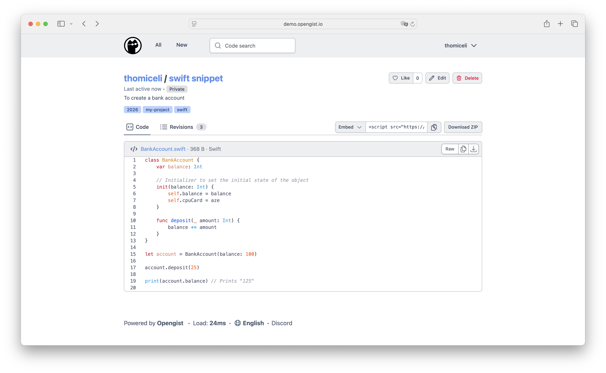

*Opengist's gist editor — upstream screenshot from the Opengist project (`docs/public/opengist-demo.png`). The live UI was verified rendering during end-to-end testing of this template's own deployment.*

# Opengist

Opengist is a self-hosted pastebin powered by Git — an open-source alternative to GitHub Gist. Create code snippets and notes as gists, each one a real Git repository you can clone, pull, and push over HTTP. Browse public gists without logging in, search code with the built-in Bleve index, and share a snippet with a link instead of pasting it into a chat. One-click deploy creates a single Go service with a persistent volume and no companion database: gists, users, and settings live in SQLite on the volume. After deploy, open the public URL and register — the first account created becomes the admin. There is no setup wizard and no email step.

## Source Repository

[https://github.com/INAPP-Mobile/opengist](https://github.com/INAPP-Mobile/opengist)

## Deploy and Host

Deploying Opengist on Railway gives you a private Gist server on your own volume. The wrapper maps Railway's injected `PORT` onto Opengist's HTTP port on every boot (upstream ignores the generic `PORT`), derives the public URL at boot from the live Railway domain, and seeds a stable session secret from the deploy form. The deploy form has one generated field and nothing to type.

## Why Deploy

- Your snippets, your Git repos: every gist is a Git repository — clone it, push updates, keep full history, instead of a paste that rots in a chat log.
- Tiny footprint: a single Go binary with embedded SQLite and Bleve search, a few MB of RAM at rest — no database service to run or pay for.
- No account needed to read: public gists are readable without logging in, so a shared link just works for anyone.
- Search that finds code: the built-in index searches gist content, titles, and authors.
- Git over HTTP: clone and push gists with plain `git` through the public URL — no SSH keys or extra ports.
- Self-hosted data: your gists stay on your Railway volume, with no tracking and no subscription.

## Common Use Cases

- A personal snippet library: shell one-liners, SQL queries, and config fragments, versioned in Git instead of scattered across notes.
- Sharing code with a team: send a gist link instead of a 200-line paste, and let teammates clone it.
- A public code notebook: publish reusable snippets with syntax highlighting and Markdown rendering.
- Replacing GitHub Gist for private work: internal snippets that never leave your own server.

## Configuration

| Variable | Default | Description |
| --- | --- | --- |
| `OG_SECRET_KEY` | `${{secret(32)}}` | Random secret for session signing and MFA data encryption. Keep it stable — changing it invalidates all user sessions. |
| `OG_HTTP_PORT` | (derived from `$PORT` at boot) | HTTP port Opengist listens on. Set by the entrypoint from Railway's injected `PORT`; do not set it yourself. |
| `OG_OPENGIST_HOME` | `/opengist` | Data home on the volume: SQLite database, gist Git repos, Bleve index, logs. Baked into the image. |
| `OG_EXTERNAL_URL` | (derived from `RAILWAY_PUBLIC_DOMAIN` at boot) | Public URL of the instance. Makes the login cookie Secure and passkeys work behind the proxy. Set manually only for a custom domain. |
| `OG_SSH_GIT_ENABLED` | `false` | Built-in SSH server for git over SSH. Disabled: Railway's public edge is HTTP-only, so port 2222 is not publicly reachable. Git over HTTP works through the proxy. |
| `OG_LOG_LEVEL` | `warn` | Log level: `debug`, `info`, `warn`, `error`, `fatal`. |
| `OG_INDEX` | `bleve` | Code indexer: `bleve`, `meilisearch`, or empty for no index. |
| `OG_CUSTOM_NAME` | (unset) | Instance name shown in the tab title instead of "Opengist". |
| `OG_GITHUB_CLIENT_KEY` / `OG_GITHUB_SECRET` | (unset) | GitHub OAuth login. |
| `OG_GITLAB_CLIENT_KEY` / `OG_GITLAB_SECRET` | (unset) | GitLab OAuth login. |
| `OG_GITEA_CLIENT_KEY` / `OG_GITEA_SECRET` | (unset) | Gitea OAuth login. |
| `OG_OIDC_PROVIDER_NAME` / `OG_OIDC_CLIENT_KEY` / `OG_OIDC_SECRET` / `OG_OIDC_DISCOVERY_URL` | (unset) | OpenID Connect login. |
| `OG_LDAP_URL` | (unset) | LDAP login; unset disables LDAP. |

## First-run notes

- **Register first, then lock the door.** The first account registered becomes the admin, and signup stays open after that. Once your users are in, go to Admin → Configuration and tick **Disable signup** so strangers cannot create accounts. (Invitations still work with signup disabled.)
- **Git over HTTP only.** The built-in SSH server is disabled in this template because Railway exposes HTTP only. Clone and push gists over HTTPS with your Opengist username and password.
- **Sessions survive redeploys.** The session secret is a generated deploy-form value that stays stable across redeploys; changing it logs everyone out.

### Deployment Dependencies

- A single Opengist service (Go, SQLite, no companion service).
- One persistent volume mounted at `/opengist` (database at `/opengist/opengist.db`, gist Git repos, Bleve index, logs).
- Plan tier: Hobby is enough — the service idles at a few MB of RAM.

## Upstream

Opengist v1.15.3 by [thomiceli](https://github.com/thomiceli/opengist), licensed AGPL-3.0. Image pinned by manifest digest; see the `Dockerfile` header for the verified digest and the wrapper's design notes.
