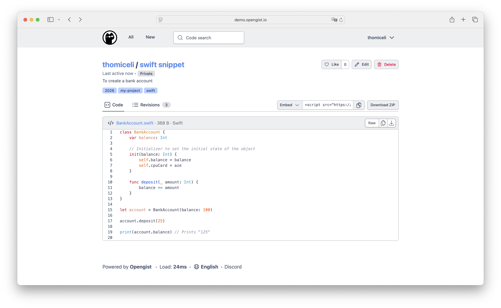

*Opengist's gist editor — upstream screenshot from the Opengist project (`docs/public/opengist-demo.png`).*

# Deploy and Host

Opengist is a self-hosted pastebin powered by Git — an open-source alternative to GitHub Gist. Create code snippets and notes as gists, each one a real Git repository you can clone, pull, and push over HTTP. One-click deploy creates a single Go service with a persistent volume and no companion database: gists, users, and settings live in SQLite on the volume. After deploy, open the public URL and register — the first account created becomes the admin. There is no setup wizard and no email step.

## About Hosting

Hosting Opengist on Railway keeps your snippets on your own volume instead of a SaaS. The deployment is a single always-on Go service: the wrapper maps Railway's injected `PORT` onto Opengist's HTTP port on every boot (upstream ignores generic `PORT`), derives the public URL at boot from the live Railway domain, and seeds a stable session secret from the deploy form. The deploy form has one generated field and nothing to type. Signup stays open by default — disable it under Admin → Configuration once your users are in.

## Why Deploy

- Your snippets, your Git repos: every gist is a Git repository — clone it, push updates, keep full history, instead of a paste that rots in a chat log.
- Tiny footprint: a single Go binary with embedded SQLite and Bleve search, a few MB of RAM at rest — no database service to run or pay for.
- No account needed to read: public gists are readable without logging in, so a shared link just works for anyone.
- Search that finds code: the built-in index searches gist content, titles, and authors.
- Git over HTTP: clone and push gists with plain `git` through the public URL — no SSH keys or extra ports.
- Self-hosted data: your gists stay on your Railway volume, with no tracking and no subscription.

## Common Use Cases

- A personal snippet library: shell one-liners, SQL queries, and config fragments, versioned in Git instead of scattered across notes.
- Sharing code with a team: send a gist link instead of a 200-line paste, and let teammates clone it.
- A public code notebook: publish reusable snippets with syntax highlighting and Markdown rendering.
- Replacing GitHub Gist for private work: internal snippets that never leave your own server.

## Dependencies for

- A single Opengist service (Go, SQLite, no companion service).
- One persistent volume mounted at `/opengist` (database at `/opengist/opengist.db`, gist Git repos, Bleve index, logs).
- Environment variables (condensed reference — full documentation in the repo README):

| Variable | Default | Description |
| --- | --- | --- |
| `OG_SECRET_KEY` | `${{secret(32)}}` | Random secret for session signing and MFA data encryption. Keep it stable — changing it invalidates all user sessions. |
| `OG_HTTP_PORT` | (derived from `$PORT` at boot) | HTTP port Opengist listens on. Set by the entrypoint from Railway's injected `PORT`. |
| `OG_OPENGIST_HOME` | `/opengist` | Data home on the volume. Baked into the image. |
| `OG_EXTERNAL_URL` | (derived from `RAILWAY_PUBLIC_DOMAIN` at boot) | Public URL of the instance. Set manually only for a custom domain. |
| `OG_SSH_GIT_ENABLED` | `false` | Built-in SSH server disabled: Railway's public edge is HTTP-only, so port 2222 is not publicly reachable. Git over HTTP works through the proxy. |

### Deployment Dependencies

- Plan tier: Hobby is enough — the service idles at a few MB of RAM.
- No companion database, no extra services.
